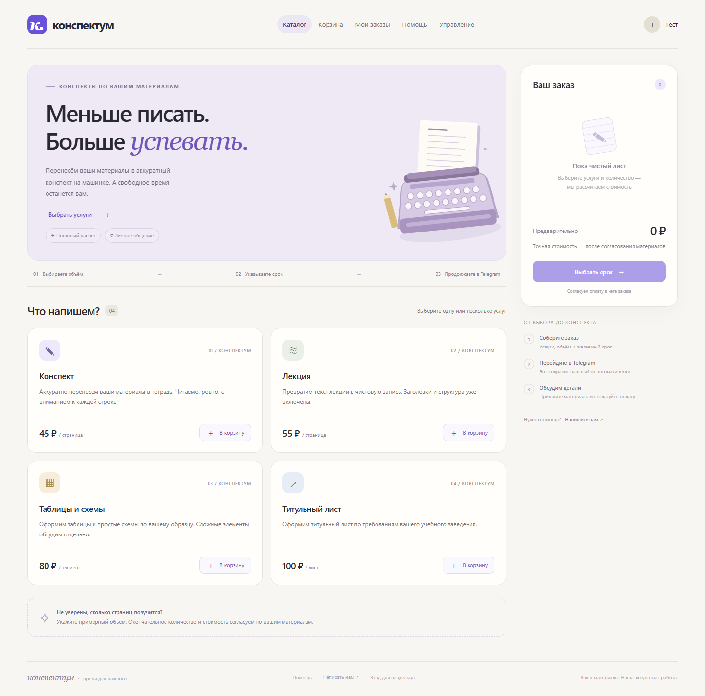
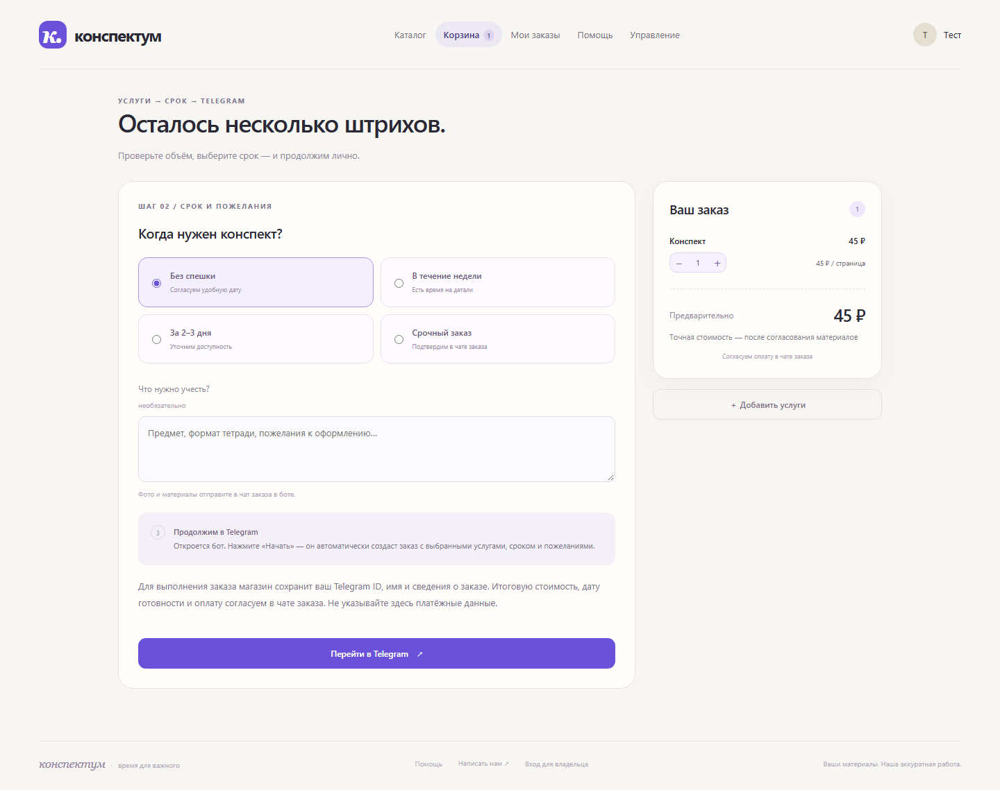
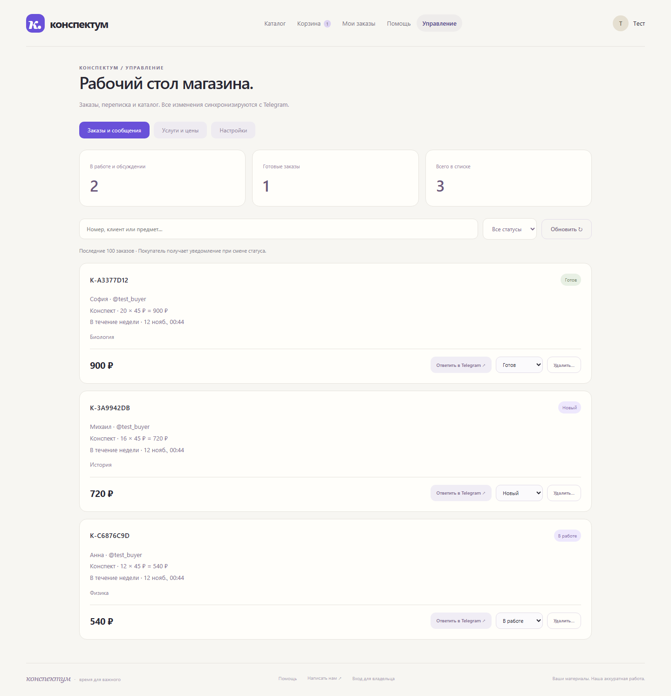
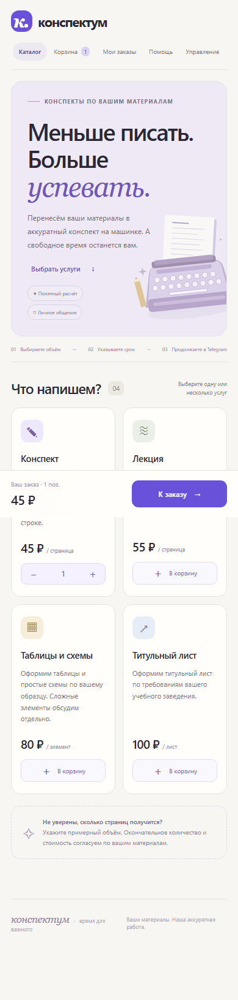
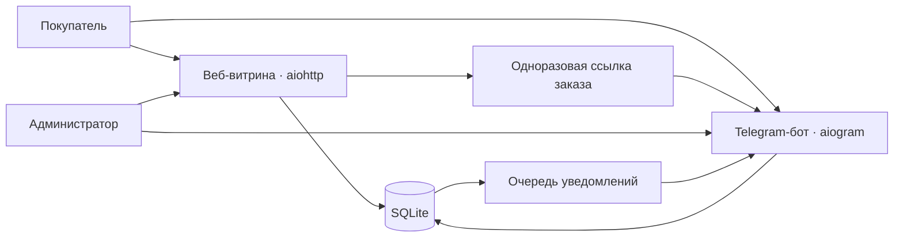

<div align="center">


# Конспектум

**Магазин конспектов: веб-витрина, Telegram-бот и единая панель управления.**

Покупатель собирает заказ на сайте, подтверждает его в Telegram и обсуждает материалы в чате заказа.

[](https://github.com/akiooooo/Konspektum-Bot/actions/workflows/checks.yml)


[Telegram-бот](https://t.me/konspektum_app) · [Быстрый старт](#быстрый-старт) · [Деплой на Timeweb](TIMEWEB.md) · [Документация](#документация)

</div>



## Возможности

| Для покупателя | Для администратора |
| --- | --- |
| Каталог, корзина и предварительная стоимость | Каталог и цены в веб-панели и боте |
| Выбор срока и комментарий к заказу | Поиск заказов и смена статусов |
| Подтверждение заказа в Telegram | Переписка с покупателем от имени бота |
| Чат заказа с фотографиями и документами | Раздельные чаты заказов и технических логов |
| История заказов после входа через Telegram | Очередь уведомлений и резервные копии SQLite |

Материалы, итоговая цена и оплата согласуются в чате заказа. Встроенного эквайринга нет.

## Интерфейс

<details>
<summary><strong>Оформление заказа</strong></summary>



</details>

<details>
<summary><strong>Панель управления</strong></summary>



</details>

<details>
<summary><strong>Мобильная витрина</strong></summary>



</details>

Скриншоты сделаны на изолированной базе с тестовыми данными.

## Как это работает



Бот и сайт используют одну базу: изменения каталога, сообщения и статусы доступны в обоих интерфейсах. Цены проверяет сервер; повторное подтверждение ссылки не создаёт второй заказ.

## Быстрый старт

Нужны Python 3.12+ и токен от [@BotFather](https://t.me/BotFather). На Windows рекомендуется обычный CPython 3.13.

```sh
git clone https://github.com/akiooooo/Konspektum-Bot.git
cd Konspektum-Bot
python run.py
```

Первый запуск создаст окружение и шаблон `.env`. Заполните настройки и повторите команду:

```dotenv
BOT_TOKEN=ваш_токен
ADMIN_IDS=ваш_числовой_telegram_id
SHOP_USERNAME=username_магазина
HOST=127.0.0.1
```

Откройте **http://127.0.0.1:8080**, нажмите **Start** в боте. Управление доступно через `/admin` или вход на сайте для аккаунта из `ADMIN_IDS`.

Для просмотра витрины без токена: `python run.py --preview`. На Linux/macOS команда Python может называться `python3`. Все параметры — в [.env.example](.env.example).

## Развёртывание

Основной вариант без Docker — **Ubuntu VPS + systemd + Nginx + HTTPS**. Пошаговая установка, перенос базы, обновление и восстановление описаны тут - [TIMEWEB.md](TIMEWEB.md).

Подготовлены отдельные systemd-сервисы приложения и резервного копирования. Дополнительный вариант с Docker Compose описан в [руководстве эксплуатации](docs/OPERATIONS.md).

Используйте одну работающую копию приложения на один токен и SQLite-базу. Публичный адрес сайта появится после настройки собственного сервера и домена.

## Разработка и проверки

```sh
python -m pip install -r requirements.lock
python -m unittest discover -s tests -v
node --check konspektum/static/shop.js
python -m pip check
python scripts/check_secrets.py
```

GitHub Actions проверяет Python 3.12/3.13 на Windows и Linux, синтаксис JavaScript, зависимости и сборку контейнера. Статус последнего запуска показан в бейдже выше.

Тесты используют временные базы и подменённый Telegram. Для просмотра панели с тестовыми заказами: `python -m tests.serve_fixture`, адрес **http://127.0.0.1:8092**. Проверка интерфейса через Playwright описана в [руководстве](docs/OPERATIONS.md).

## Структура

```text
konspektum/         бот, HTTP API, хранилище и веб-интерфейс
tests/              модульные и интеграционные проверки
deploy/             systemd, Nginx и установка на VPS
scripts/            диагностика, проверки и сборка архива
docs/               руководство, скриншоты и материалы оформления
.github/            CI и шаблоны обращений
```

## Безопасность

Проверка Telegram-авторизации, контроль владельца заказа, CSRF, одноразовые ссылки, ограничение запросов и серверный расчёт цен реализованы в приложении. Секреты и рабочие данные исключены из Git.

Ограничения, порядок сообщения об уязвимости и рекомендации по эксплуатации — в [SECURITY.md](SECURITY.md). Сервис рассчитан на один процесс и небольшой магазин; масштабирование требует пересмотра архитектуры.

## Документация

- [Эксплуатация и подробные сценарии](docs/OPERATIONS.md)
- [Установка на Timeweb без Docker](TIMEWEB.md)
- [Безопасность](SECURITY.md)
- [Тексты и оформление Telegram](docs/TELEGRAM.md)
- [Вклад в проект](CONTRIBUTING.md)
- [Описание для портфолио](PORTFOLIO.md)

## Обратная связь

Нашли ошибку — [создайте issue](https://github.com/akiooooo/Konspektum-Bot/issues/new/choose), указав шаги воспроизведения и ожидаемое поведение. Не прикладывайте токены, рабочую базу и переписку покупателей.
